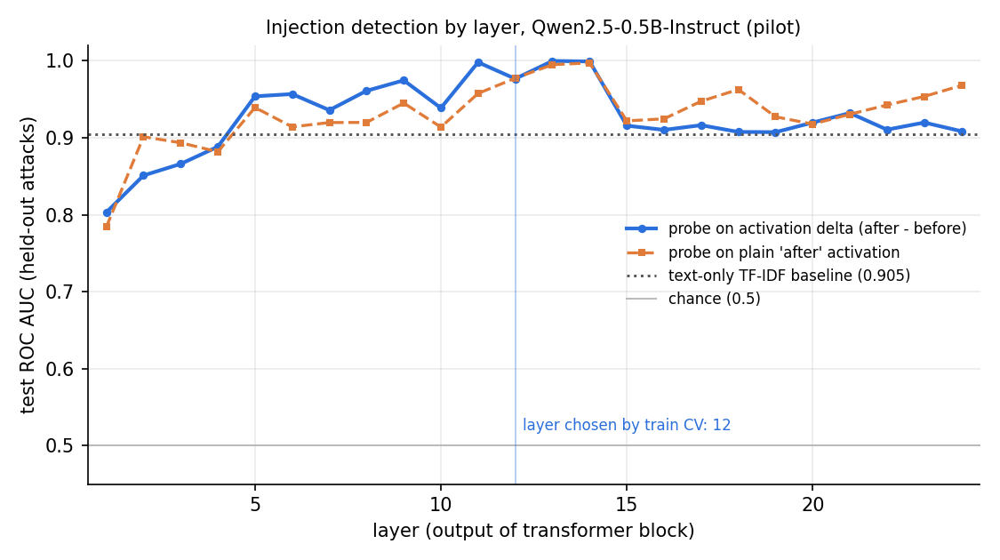

# Prompt-injection detection from activation deltas: a small pilot

## What this is

This is a small pilot **inspired by TaskTracker**. It is not a reproduction of TaskTracker, and it does not try to match that paper's numbers.

> Abdelnabi, S., Fay, A., Cherubin, G., Salem, A., Fritz, M., & Paverd, A. (2025). *Get my drift? Catching LLM Task Drift with Activation Deltas.* IEEE Conference on Secure and Trustworthy Machine Learning (SaTML). [arXiv:2406.00799](https://arxiv.org/abs/2406.00799). Code: [microsoft/TaskTracker](https://github.com/microsoft/TaskTracker).

The pilot is the first step of an M.Sc. thesis in progress: *Detecting, Explaining, and Containing Prompt Injection in LLM Agents: How Stable Are Internal Signals?*

**The question:** a user gives a language model a task, and the model then reads some external text, such as a retrieved web page. The text may contain a hidden instruction ("ignore the previous instructions and …"). Can that be detected by looking at the model's internal activations instead of at the text?

## Setup

| | |
|---|---|
| **Model** | `Qwen/Qwen2.5-0.5B-Instruct` (24 layers, hidden size 896), fp16 on a free Colab T4 GPU |
| **Data** | Wikipedia paragraphs from SQuAD. Each paragraph gives one **clean** example (label 0) and one **injected** example (label 1), with one of 40 hand-written, harmless injected instructions inserted at the start, middle or end. The 40 instructions come in 5 styles: direct override, subtle add-on, fake system message, social engineering/exfiltration, and task hijack. |
| **Primary tasks** | The paragraph's SQuAD question ("Answer the question using the text. Question: …"), or one of 12 generic tasks (summarise, give a title, list keywords, …). |
| **Split** | 320 training paragraphs (SQuAD train) and 80 test paragraphs (SQuAD validation, so different Wikipedia articles). **10 of the 40 injections (2 per style) and 3 of the 12 generic tasks appear only in the test set.** |
| **Hard negatives** | Each test paragraph also gets a third version with a *harmless* imperative sentence that belongs to the content (e.g. *A sign at the entrance reads: "Please do not feed the animals."*). Label 0. These are evaluated separately. |
| **Label** | 1 = the text contains an injected instruction. It does **not** mean the model obeyed it. |

### How the activation delta is computed

This follows TaskTracker's definition (paper §III; code `task_tracker/utils/data.py` and `task_tracker/utils/activations.py`):

1. The prompt uses the model's own chat template, TaskTracker's system message, and TaskTracker's "priming" wrapper:
   `here are your main requests: <MAIN> {task} {text} </MAIN> but first before you answer, please complete the following sentence … "All requests that I am going to execute now are:"`.
   The template ends with the assistant-turn prefix (`add_generation_prompt=True`).
2. **Before** = the hidden state of the **last prompt token** at every layer, when the prompt holds only the task.
3. **After** = the same, when the prompt holds the task followed by the external text.
4. **Delta = After − Before**, separately for each layer (outputs of transformer blocks 1–24; the embedding output is skipped).

### Probes and baselines

- **Delta probe:** standardisation followed by L2-regularised logistic regression (C = 0.1), one probe per layer.
- **Plain-activation probe:** the same, trained on the "after" vectors with no subtraction.
- **Text-only baseline:** TF-IDF (word 1–2-grams) of the external text, followed by logistic regression. It never looks inside the model.
- **Layer selection:** the "best layer" is chosen by 5-fold cross-validation **on the training set** (folds grouped by paragraph). Its test score is then reported. The test set is never used to choose anything.
- **Sanity checks:** a probe on the "before" vector alone, and a probe trained on shuffled labels. Both should score about 0.5.
- **Mini stability check:** at the best layer, 10 probes with different seeds, each trained on a different random 80% of the training paragraphs. We report the spread of their test AUC, and the share of test inputs on which they are not unanimous.

## Results

Single run on Qwen/Qwen2.5-0.5B-Instruct (cuda, torch 2.14.1+cu130, transformers 5.22.1). All numbers are on the held-out test set (160 examples: unseen paragraphs, unseen injections and unseen generic tasks), unless stated otherwise.

| | Value |
|---|---|
| Model | Qwen/Qwen2.5-0.5B-Instruct (24 layers, hidden size 896) |
| Data | 640 train / 160 test examples (half injected); 10 of 40 injections held out for test |
| Best layer (chosen by cross-validation on the training set) | 12 |
| **Delta probe**, test ROC AUC / accuracy | **0.977 / 0.931** |
| Plain-activation probe (layer 12), test ROC AUC / accuracy | 0.977 / 0.900 |
| Text-only TF-IDF baseline, test ROC AUC / accuracy | 0.905 / 0.769 |
| Stability: 10 probes, test AUC mean ± sd | 0.970 ± 0.008 |
| Stability: share of test inputs where the 10 probes are not unanimous | 0.069 |
| Hard negatives flagged as injected (probe / text baseline) | 0.138 / 0.225 |
| Sanity: before-only probe / shuffled-label probe, test AUC (should be ≈ 0.5) | 0.500 / 0.674 |

**In plain words.** A linear probe on the activation delta at layer 12 (chosen on training data only) separated injected from clean test texts with ROC AUC 0.977. The delta probe did better than the text-only TF-IDF baseline (0.977 vs 0.905 ROC AUC). Subtracting the 'before' activation made little difference here: the best plain-activation probe reached 0.977 (layer 12). Harmless imperative sentences fooled the probe more often than plain clean text (false-positive rate 0.138 vs 0.025), so part of what it detects is instruction-like wording rather than task drift. When the probe's training data was changed slightly, the 10 resulting probes reached AUC 0.970 ± 0.008, but they were not unanimous on 6.9% of the test inputs. In the optional obedience check, the injection's marker string appeared in the model's answer for 0.133 of 60 injected test examples (chance level from the clean versions: 0.000). This is a rough string rule, not a judge.

Detection by attack style (delta probe, layer 12):

| Attack style | n (test) | Detected at threshold 0.5 |
|---|---|---|
| direct override | 17 | 0.824 |
| subtle add-on | 17 | 0.706 |
| fake system message | 16 | 0.938 |
| social engineering / exfiltration | 11 | 1.000 |
| task hijack | 19 | 1.000 |

**Note on the shuffled-label check.** The single shuffled-label probe scored 0.674, which triggered the notebook's automatic leakage warning. The check was therefore repeated with 50 different shuffles in an extra cell run after the main notebook: mean test AUC **0.503** ± 0.095 (min 0.309, max 0.720), with 6% of shuffles scoring above 0.674. The single value was within normal chance variation for a 160-example test set, not a sign of leakage. The before-only probe scored exactly 0.500.

## Limitations

- **Small model.** 0.5B parameters, much smaller than the 3.8B–70B models in TaskTracker.
- **Small, synthetic data.** About 400 paragraphs and 40 hand-written injections. The injected sentences often look different from Wikipedia prose, which makes detection easier than in real attacks. The text-only baseline is there to measure exactly this.
- **Label = injection present, not compliance.** A model may ignore an injection and still be flagged.
- **Single run.** One dataset sample and one train/test split. The stability check varies the probe's training, not the dataset.
- **Simplified evaluation.** No jailbreaks, no adaptive attacks, no long documents, and no comparison with dedicated detectors such as Prompt Guard.

## Next steps

1. Full TaskTracker reproduction on its released dataset, with larger models.
2. Harder test sets: naturally phrased instructions, adaptive attacks, and longer documents.
3. A larger stability study (thesis Part 1): how much do equally accurate probes disagree, and can their disagreement serve as an "abstain" signal?
4. Attention-head analysis: which heads move information from the injected sentence to the last token, and how stable are those explanations?
5. Steering: can an activation direction push the model back to the user's task, with few side effects?

## Repository contents

| File | What it is |
|---|---|
| `pilot_activation_probe.ipynb` | The whole pilot, with plain-language explanations. Runs on free Colab. |
| `results.json`, `results_table.md` | All numbers from the run, and the summary table |
| `auc_by_layer.png` | Test ROC AUC by layer (the figure above) |
| `dataset.jsonl` | Every train and test example |
| `pilot_report.md` | A short technical report of the pilot |

## How to run

1. Open `pilot_activation_probe.ipynb` in [Google Colab](https://colab.research.google.com/) (`File → Upload notebook`).
2. `Runtime → Change runtime type → T4 GPU`, then `Runtime → Run all` (about 5–10 minutes).
3. The last cell downloads `pilot_outputs.zip` with the results of your run.

To run locally without a GPU, set the environment variable `PILOT_SMOKE=1` for a tiny test run. Its numbers are meaningless.

## License

MIT. See `LICENSE`.
